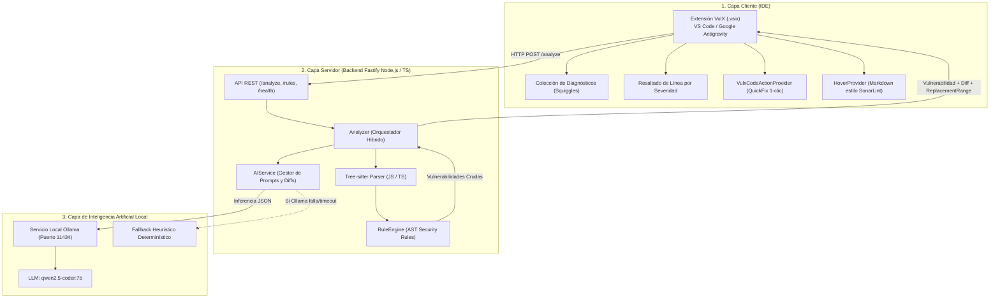

# 🛡️ VulX — Sistema Inteligente de Detección y Remediación Asistida de Vulnerabilidades

[]()
[]()
[]()
[]()
[]()
[]()
[](https://opensource.org/licenses/ISC)

> **VulX** es una plataforma DevSecOps de próxima generación que opera **100% de manera local y privada**. Integra análisis sintáctico determinístico con **Tree-sitter** e inteligencia artificial generativa local con **Ollama (Qwen 2.5 Coder 7B)** para detectar vulnerabilidades en código JavaScript y TypeScript, explicarlas contextualmente y aplicar parches de seguridad en **un solo clic** directamente en el editor.

---

## 📑 Tabla de Contenidos

1. [Arquitectura General](#-arquitectura-general)
2. [Matriz de Vulnerabilidades Cubiertas](#-matriz-de-vulnerabilidades-cubiertas)
3. [Requisitos Previos del Sistema](#-requisitos-previos-del-sistema)
4. [Guía de Instalación y Configuración de Ollama](#-guía-de-instalación-y-configuración-de-ollama)
5. [Instalación y Puesta en Marcha del Backend](#-instalación-y-puesta-en-marcha-del-backend)
6. [Manual de Uso de la Extensión en el IDE](#-manual-de-uso-de-la-extensión-en-el-ide)
7. [Referencia de la API REST (OpenAPI / Swagger)](#-referencia-de-la-api-rest-openapi--swagger)
8. [Resolución de Problemas (Troubleshooting)](#-resolución-de-problemas-troubleshooting)
9. [Guía de Desarrollo y Pruebas Automatizadas](#-guía-de-desarrollo-y-pruebas-automatizadas)
10. [Licencia y Contribución](#-licencia-y-contribución)

---

## 🏛️ Arquitectura General

VulX implementa una arquitectura híbrida desacoplada en tres capas que garantiza **privacidad absoluta** (el código fuente nunca sale de la estación de trabajo) y **baja latencia**:



### Flujo del Pipeline de Análisis:
1. **Intercepción**: El cliente captura el buffer del código (al guardar o bajo demanda con atajo de teclado).
2. **Parseo AST (< 50ms)**: Tree-sitter genera el Árbol de Sintaxis Abstracta estructurado.
3. **Detección Determinística**: Las reglas de seguridad identifican patrones peligrosos sin falsos positivos sintácticos.
4. **Auditoría Semántica Profunda (Opcional - DeepScan)**: Inferencia completa de contexto para patrones complejos de lógica.
5. **Enriquecimiento con IA**: Ollama genera la explicación técnica, el diff unificado estilo Git y las coordenadas exactas `replacementRange`.
6. **Remediación en 1 Clic**: El editor recibe el `WorkspaceEdit` y aplica el parche asistido con preservación de indentación.

---

## 🛡️ Matriz de Vulnerabilidades Cubiertas

| Identificador | Nombre de la Vulnerabilidad | CWE Base | Severidad | Método de Detección | Estrategia de Remediación |
| :--- | :--- | :--- | :--- | :--- | :--- |
| **`DOM_XSS`** | Manipulación Insegura del DOM (XSS) | CWE-79 | `HIGH` | AST sobre `innerHTML`, `outerHTML`, `document.write()` | Sustitución por `textContent` o sanitización estructurada con DOMPurify. |
| **`SQL_INJECTION`** | Posible Inyección SQL | CWE-89 | `CRITICAL` | AST sobre concatenación (`+`) y template literals en queries | Parametrización estricta de consultas con marcadores `$1, $2` o tuplas preparadas. |
| **`HARDCODED_SECRET`** | Secreto Codificado en el Código | CWE-798 | `CRITICAL` | Expresiones regulares + entropía sobre tokens y API keys (AWS, GitHub, JWT) | Extracción segura a variables de entorno (`process.env.VARIABLE`). |
| **`COMMAND_INJECTION`**| Inyección de Comandos del Sistema Operativo | CWE-78 | `CRITICAL` | AST sobre invocaciones no sanitizadas a `child_process.exec()` | Migración a `execFile` o `spawn` con argumentos en array aislado. |
| **`PATH_TRAVERSAL`** | Recorrido de Rutas Arbitrario | CWE-22 | `HIGH` | AST sobre concatenaciones en APIs de `fs` (`readFile`, `createReadStream`) | Normalización canónica con `path.resolve()` y validación de prefijo seguro. |
| **`EVAL_USAGE`** | Uso Peligroso de `eval()` | CWE-95 | `CRITICAL` | AST sobre llamadas directas o indirectas a `eval()` | Reemplazo por parseo seguro mediante `JSON.parse()` o evaluadores matemáticos acotados. |

---

## 💻 Requisitos Previos del Sistema

- **Sistema Operativo**: Windows 10/11 (x64), macOS (Apple Silicon / Intel) o Linux (Ubuntu 20.04+, Debian, Fedora).
- **Node.js**: Versión `v20.x` o `v22.x` LTS instalada.
- **npm**: Versión `10.x` o superior.
- **Editor**: [Visual Studio Code](https://code.visualstudio.com/) (v1.90.0+) o [Google Antigravity IDE](https://antigravity.google/).
- **RAM**:
  - Mínimo: **8 GB** (ejecución con fallback heurístico o modelo liviano `1.5b`).
  - Recomendado: **16 GB** (para inferencia fluida de `qwen2.5-coder:7b` en GPU/CPU).
- **Aceleración GPU (Opcional pero muy recomendada)**: NVIDIA CUDA (Compute Capability 5.0+), Apple Silicon Metal, o AMD ROCm.

---

## 🦙 Guía de Instalación y Configuración de Ollama

VulX utiliza **Ollama** como motor de inferencia local para garantizar que tu código fuente jamás sea transmitido a servidores de terceros en la nube.

### 1. Descarga e Instalación

#### En Windows:
1. Descarga el instalador oficial desde [ollama.com/download/windows](https://ollama.com/download/windows).
2. Ejecuta `OllamaSetup.exe` y sigue el asistente.
3. Verifica la instalación abriendo PowerShell:
   ```powershell
   ollama --version
   ```

#### En macOS:
1. Descarga el archivo zip desde [ollama.com/download/mac](https://ollama.com/download/mac) o mediante Homebrew:
   ```bash
   brew install ollama
   ```

#### En Linux:
```bash
curl -fsSL https://ollama.com/install.sh | sh
```

---

### 2. Descargar el Modelo Recomendado

VulX está calibrado para trabajar con **Qwen 2.5 Coder 7B**, un modelo de lenguaje especializado en seguridad, sintaxis y generación de código:

```bash
ollama run qwen2.5-coder:7b
```
> 💡 *Nota*: Si tu máquina tiene 8 GB de RAM o carece de GPU dedicada, puedes usar la versión compacta de menor consumo:
> ```bash
> ollama run qwen2.5-coder:1.5b
> ```

---

### 3. Verificar la Disponibilidad del Servicio Local

Ollama expone un servicio REST en el puerto `11434`. Abre una terminal o navegador y comprueba:

```bash
curl http://127.0.0.1:11434/
```
*Respuesta esperada:* `Ollama is running`

Para listar los modelos descargados y listos:
```bash
ollama list
```

---

### 4. Variables de Entorno de Ollama (Opcional)

Si necesitas personalizar la conexión de Ollama, puedes configurar en tu terminal o archivo `.env`:

| Variable | Valor por Defecto | Descripción |
| :--- | :--- | :--- |
| `OLLAMA_HOST` | `http://127.0.0.1:11434` | URL base del daemon local de Ollama. |
| `OLLAMA_MODEL` | `qwen2.5-coder:7b` | Modelo LLM a utilizar para remediaciones y DeepScan. |
| `OLLAMA_TIMEOUT_MS` | `15000` (15 segundos) | Tiempo máximo de espera antes de activar el fallback heurístico. |

---

## 🚀 Instalación y Puesta en Marcha del Backend

### 1. Clonar el Repositorio

```bash
git clone https://github.com/lexxx02/Vul_X.git
cd Vul_X
```

Asegúrate de estar en la rama de desarrollo:
```bash
git checkout roland
```

### 2. Instalar Dependencias

Instala los paquetes en la raíz del proyecto y en el submódulo de la extensión:

```bash
# Dependencias del servidor backend
npm install

# Dependencias de la extensión de VS Code
npm --prefix extension install
```

### 3. Iniciar el Servidor de Análisis

Inicia el servidor en modo desarrollo con recarga en caliente (*hot-reload* vía `tsx`):

```bash
npm run dev
```

*Salida esperada:*
```text
Servidor de VulX escuchando en http://localhost:3000
```

Puedes verificar el estado abriendo en tu navegador o mediante curl:
```bash
curl http://127.0.0.1:3000/health
# {"status":"ok","timestamp":"2026-11-09T..."}
```

---

## 🔌 Manual de Uso de la Extensión en el IDE

La extensión de VulX integra todas las capacidades del analizador directamente en **Visual Studio Code** y **Google Antigravity IDE**.

### 1. Instalación de la Extensión

#### Opción A: Mediante el archivo empaquetado `.vsix` (Recomendado para usuarios)
1. Localiza el archivo compilado en `extension/vulx-extension-0.1.0.vsix`.
2. En VS Code / Antigravity:
   - Abre la pestaña de **Extensiones** (<kbd>Ctrl + Shift + X</kbd>).
   - Haz clic en el menú de tres puntos (`...`) en la esquina superior derecha.
   - Selecciona **"Install from VSIX..."** (*Instalar desde VSIX...*).
   - Elige el archivo `vulx-extension-0.1.0.vsix`.

#### Opción B: Modo Desarrollo con F5 (Para desarrolladores)
1. Abre la carpeta `Vul_X` en VS Code.
2. Presiona <kbd>F5</kbd> (o selecciona en la pestaña de Debug: *"Ejecutar Extensión VulX (F5)"*).
3. Se abrirá una nueva ventana aislada: `[Extension Development Host]` con la extensión cargada en tiempo real.

---

### 2. Modos de Activación (Triggers)

VulX ofrece dos mecanismos de activación complementarios:

1. **Trigger Automático al Guardar (`onSave`)**:
   - Cada vez que guardas un archivo con <kbd>Ctrl + S</kbd> en JavaScript (`.js`, `.jsx`) o TypeScript (`.ts`, `.tsx`), VulX analiza el archivo automáticamente en segundo plano.
2. **Trigger Bajo Demanda (`onDemand`)**:
   - Puedes disparar un escaneo manual instantáneo en el archivo activo mediante:
     - Atajo de teclado: <kbd>Ctrl + Alt + A</kbd> (Windows/Linux) o <kbd>Cmd + Alt + A</kbd> (macOS).
     - Atajo secundario: <kbd>Alt + Shift + V</kbd>.
     - Clic en el icono del escudo en la **Barra de Estado** inferior (`$(shield) VulX: Listo`).
     - Clic derecho en el editor -> *"VulX: Analizar archivo activo (Bajo demanda)"*.

---

### 3. Indicadores Visuales en el Editor

Cuando se detecta una vulnerabilidad, la extensión despliega 4 niveles de retroalimentación inmediata:

1. **Subrayados Ondulados (Squiggles)**: Las líneas afectadas se subrayan en rojo (crítico/alto) o amarillo (medio).
2. **Resaltado de Línea Completa (Line Highlights)**:
   - 🔴 **Rojo** (`#dc2626`): Severidad Crítica (SQLi, Secretos, Command Injection).
   - 🟠 **Naranja** (`#ea580c`): Severidad Alta (DOM XSS, Path Traversal).
   - 🟡 **Amarillo** (`#ca8a04`): Severidad Media.
   - 🔵 **Azul** (`#2563eb`): Severidad Baja / Informativa.
3. **Panel de Problemas**: Presiona <kbd>Ctrl + Shift + M</kbd> para ver la lista consolidada de hallazgos del proyecto con su número de línea y recomendación técnica.
4. **Tooltips Enriquecidos (HoverProvider)**: Al posar el puntero del mouse sobre la línea vulnerable, se despliega una tarjeta técnica en Markdown estilo SonarLint con insignias `<kbd>`, descripción del vector de ataque, fragmento detectado y previsualización del diff.

---

### 4. Aplicar Parches Asistidos con Quick Fix (1 solo clic)

VulX no solo detecta vulnerabilidades, sino que **resuelve el código en 1 clic**:

#### Vía A: La Bombilla Amarilla (💡)
1. Coloca el cursor sobre la línea subrayada.
2. Presiona <kbd>Ctrl + .</kbd> (o haz clic en el icono de la **bombilla 💡** en el margen izquierdo).
3. Selecciona:
   > **`💡 VulX Fix: [Explicación técnica de la corrección]`**
4. Haz un solo clic: el código vulnerable será reemplazado inmediatamente por el código seguro respetando la indentación original.

#### Vía B: Atajo Global de Reemplazo
- Presiona <kbd>Ctrl + Alt + F</kbd> (o <kbd>Cmd + Alt + F</kbd> en Mac).
- Si hay múltiples alertas en el archivo, se desplegará un menú interactivo (`QuickPick`) para que selecciones cuál parchar de forma guiada.

---

### 5. Configuración de la Extensión

Puedes personalizar el comportamiento en `Configuración` (<kbd>Ctrl + ,</kbd>) buscando `VulX`:

| Parámetro | Tipo | Por Defecto | Descripción |
| :--- | :--- | :--- | :--- |
| `vulx.apiUrl` | `string` | `http://127.0.0.1:3000` | URL del servidor REST local de VulX. |
| `vulx.enableOnSave` | `boolean` | `true` | Habilita/deshabilita el análisis automático al guardar. |
| `vulx.analysisTrigger`| `enum` | `"both"` | Modos: `"both"` (guardar y manual), `"onSave"`, o `"onDemand"`. |
| `vulx.deepScan` | `boolean` | `false` | Habilita la auditoría semántica profunda con IA local. |
| `vulx.showNotifications`| `boolean`| `true` | Muestra notificaciones emergentes con el resumen del análisis. |

---

## 📖 Referencia de la API REST (OpenAPI / Swagger)

La especificación completa en formato OpenAPI 3.0.3 se encuentra en:
👉 [`docs/api-spec.yaml`](Docs/api-spec.yaml)

### Resumen de Endpoints:

#### 1. `GET /health`
Verifica que el servicio esté arriba.
```bash
curl http://127.0.0.1:3000/health
```
```json
{
  "status": "ok",
  "timestamp": "2026-11-09T21:40:00.000Z"
}
```

#### 2. `GET /rules`
Lista las 6 reglas activas registradas en el RuleEngine.
```bash
curl http://127.0.0.1:3000/rules
```

#### 3. `POST /analyze` (o `/api/v1/analyze`)
Ejecuta el análisis sobre un fragmento o archivo completo.

**Ejemplo de Petición:**
```bash
curl -X POST http://127.0.0.1:3000/analyze \
  -H "Content-Type: application/json" \
  -d '{
    "code": "function render(data) { document.getElementById(\"box\").innerHTML = data; }",
    "language": "javascript",
    "includeRemediation": true,
    "deepScan": false
  }'
```

**Ejemplo de Respuesta:**
```json
{
  "status": "success",
  "message": "Análisis completado: se detectaron 1 vulnerabilidad(es)",
  "analysis": {
    "vulnerabilities": [
      {
        "id": "DOM_XSS",
        "name": "Manipulación insegura del DOM (XSS)",
        "description": "Asignación directa a innerHTML detectada...",
        "severity": "high",
        "line": 1,
        "column": 23,
        "codeSnippet": "document.getElementById(\"box\").innerHTML = data;",
        "recommendation": "Evita asignar directamente a innerHTML. Utiliza textContent.",
        "remediation": {
          "explanation": "Reemplazar innerHTML por textContent para mitigar XSS",
          "fixedSnippet": "document.getElementById(\"box\").textContent = data;",
          "diff": "- document.getElementById(\"box\").innerHTML = data;\n+ document.getElementById(\"box\").textContent = data;",
          "replacementRange": {
            "startLine": 1,
            "endLine": 1,
            "startColumn": 23,
            "endColumn": 71
          }
        }
      }
    ],
    "summary": {
      "total": 1,
      "critical": 0,
      "high": 1,
      "medium": 0,
      "low": 0,
      "durationMs": 42
    }
  }
}
```

---

## 🛠️ Resolución de Problemas (Troubleshooting)

### 1. El editor muestra: *"No se pudo conectar con el servidor local en http://127.0.0.1:3000"*
* **Causa**: El servidor backend de Node.js no está en ejecución.
* **Solución**:
  1. Abre una terminal en la carpeta raíz `Vul_X`.
  2. Ejecuta `npm run dev`.
  3. Verifica que la consola indique `Servidor de VulX escuchando en http://localhost:3000`.
  4. En el editor, haz clic en el icono del escudo de la barra de estado para reintentar.

---

### 2. Mensaje en logs: *"[VulX/AIService] Fallback heurístico activado: fetch failed"*
* **Causa**: Ollama no está iniciado o está bloqueado en el puerto `11434`.
* **Impacto**: Ninguno crítico. VulX está diseñado con **resiliencia total**: si Ollama no responde, el motor heurístico determinístico genera automáticamente el parche y el diff sin interrumpir el trabajo del desarrollador.
* **Solución para habilitar la IA completa**:
  1. Verifica que Ollama esté corriendo: `curl http://127.0.0.1:11434/`.
  2. Si no responde, inicia la aplicación Ollama desde tu menú de inicio o ejecuta en terminal: `ollama serve`.
  3. Comprueba que el modelo esté descargado: `ollama list`. Si no aparece, descárgalo: `ollama pull qwen2.5-coder:7b`.

---

### 3. El análisis demora más de 15 segundos o lanza *Timeout*
* **Causa**: Inferencia de Ollama lenta ejecutándose en CPU sin aceleración por GPU.
* **Solución**:
  1. Usa un modelo más liviano: `ollama pull qwen2.5-coder:1.5b`.
  2. Configura en el backend la variable `OLLAMA_MODEL=qwen2.5-coder:1.5b`.
  3. Si tienes tarjeta gráfica NVIDIA, asegúrate de tener instalados los controladores CUDA más recientes para que Ollama cargue las capas en VRAM.

---

### 4. No aparece la bombilla amarilla (💡) ni el Quick Fix
* **Causa**: El cursor no está posicionado exactamente sobre el rango diagnosticado, o el archivo tiene un lenguaje no soportado.
* **Solución**:
  1. Asegúrate de que el archivo esté identificado como `JavaScript` o `TypeScript` en la esquina inferior derecha del IDE.
  2. Haz clic directamente sobre la palabra subrayada en rojo o amarillo.
  3. Presiona el atajo directo: <kbd>Ctrl + Alt + F</kbd> para forzar la apertura del selector `QuickPick`.
  4. Revisa la consola de salida dedicada en el menú: **View -> Output -> Seleccionar "VulX Security"**.

---

### 5. Error en Tree-sitter al compilar en Windows (`node-gyp` o binding nativo)
* **Causa**: Falta de herramientas de compilación C++ para módulos nativos de Node.js.
* **Solución**:
  1. Abre PowerShell como Administrador.
  2. Ejecuta: `npm install --global --production windows-build-tools` o instala *Visual Studio Community* marcando la opción *"Desarrollo para el escritorio con C++"*.
  3. En la carpeta del proyecto ejecuta: `npm rebuild tree-sitter tree-sitter-javascript tree-sitter-typescript`.

---

## 🧪 Guía de Desarrollo y Pruebas Automatizadas

VulX cuenta con una rigurosa suite de pruebas unitarias y de integración que utiliza el runner nativo de Node.js (`node:test`) y TypeScript estricto.

### Ejecutar todas las pruebas unitarias del backend:
```bash
npm test
```

### Ejecutar los 32 tests unitarios del Quick Fix (`VulxCodeActionProvider`):
```bash
npx tsx --test test/VulxCodeActionProvider.test.ts
```

### Ejecutar verificación estricta de tipos TypeScript:
```bash
npm run typecheck
```

### Ejecutar suite integral de verificación de triggers y compatibilidad:
```bash
npm run verify:triggers
```

### Recompilar y empaquetar la extensión:
```bash
npm run compile:extension
npm run package:extension
```

---

## 👥 Autores y Contribución

Proyecto desarrollado para la plataforma de seguridad estática y asistida **VulX**.

* **Roland Sandoval** ([@Roland23-dal](https://github.com/Roland23-dal)) — Rama de desarrollo: `roland`
* **Repositorio Oficial**: [github.com/lexxx02/Vul_X](https://github.com/lexxx02/Vul_X)

---

## 📄 Licencia

Este proyecto está distribuido bajo la licencia **ISC**. Consulta el archivo `LICENSE` o `package.json` para más detalles.

